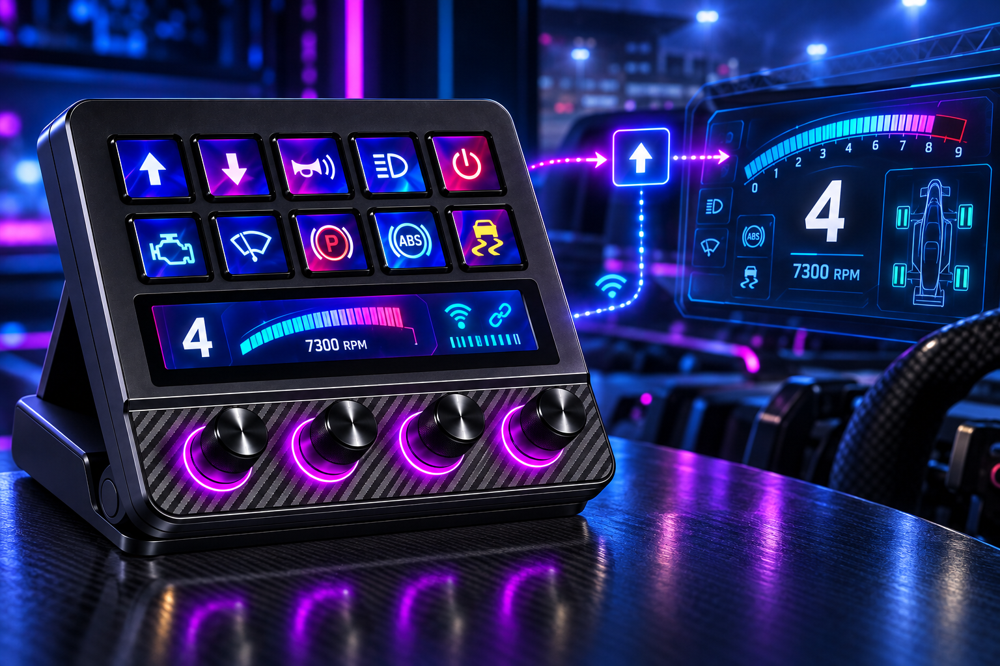
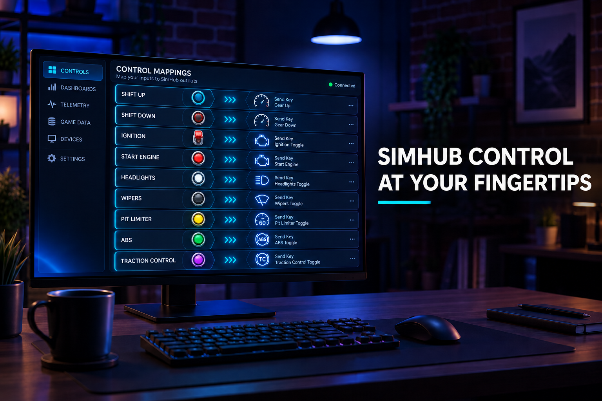
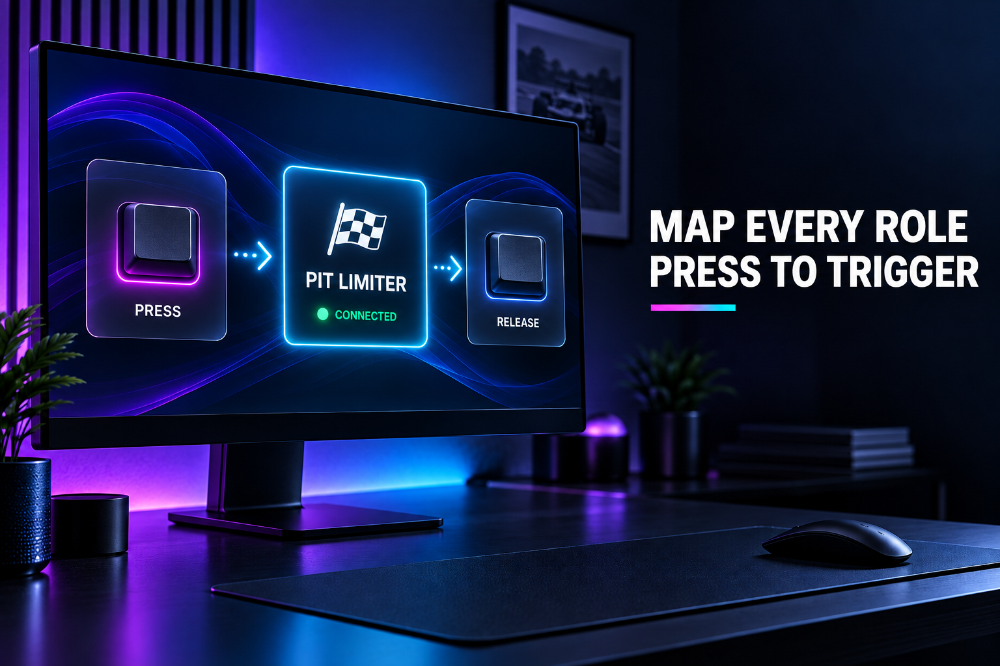

# StreamDock SimHub

将 StreamDock 的实体按键连接到 SimHub。插件保留 SimHub 官方 Stream Deck 插件的核心触发逻辑，并适配为 StreamDock 插件结构；所有请求仅发送到本机 SimHub 服务。

## 功能

### Trigger Control Mapper Role

触发 SimHub Control Mapper 中配置好的角色：

- 按下实体按键时发送 `StartRole`
- 松开实体按键时发送 `StopRole`
- 适合换挡、点火、车灯、雨刷、限速器等需要“按下/松开”状态的控制

### Trigger SimHub Input

按名称触发 SimHub 输入：

- 按下实体按键时发送 `Press`
- 松开实体按键时发送 `Release`
- 可用于已经在 SimHub 中创建或暴露的命名输入

## 使用方法

1. 启动 SimHub，并保持其本地服务可用。
2. 启动 StreamDock，将 **SimHub** 分类下需要的动作拖到实体按键。
3. 在右侧属性面板选择 Control Mapper Role，或填写 SimHub Input 名称。
4. 按下和松开实体按键，观察 SimHub 中对应功能是否触发。

插件连接地址为 `http://127.0.0.1:8888`，不会把控制请求发送到外部网络。如果按键无响应，请先确认 SimHub 正在运行，并检查目标 Role/Input 名称是否与 SimHub 中完全一致。

## 多语言

内置简体中文、英语、德语、西班牙语、法语、日语、韩语、葡萄牙语和俄语。插件分类和两个动作共用同一个 **SimHub** 分类标题。

## 构建与部署

在 Windows 上运行 `build.bat`，脚本会编译 Release 版本并部署到 StreamDock 插件目录。插件标识为 `com.streamdock.simhub`。

## 来源说明

触发语义参考 SimHub 官方 Stream Deck 插件；本项目仅完成 StreamDock 的清单、属性面板、本地通信与打包适配。SimHub 是其各自权利人的产品与商标。
